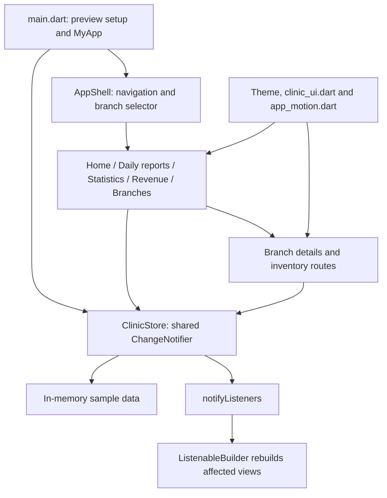
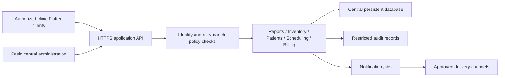

# Architecture

> Veritas Prototype 0.1 · Centralized Multi-Branch Clinic Administration System
> Implementation reviewed: 16 October 2026

A technical map of the current Flutter prototype and the proposed path to a shared clinic administration system.

Related documents: [Product requirements](PRD.md) · [Design system](DESIGNSYSTEM.md) · [Workflows](WORKFLOW.md) · [Run instructions](README.md)

## 01 · System overview

The current application is a single Flutter client. It opens directly into the owner dashboard and creates a shared `ClinicStore` containing sample branch, report, inventory, and staff data. There is no running backend, database, authentication service, or network synchronization.

The project folder is `veritas_prototype 0.1`; the Dart package remains `demo_demo`, the package version is `1.0.0+1`, and the UI brand is **Vista Care**. These identifiers serve different purposes. Renaming the folder did not rename the Dart package.

### Current architecture



**Boundary:** branch filtering changes what is displayed. It does not enforce authorization. All mutations are local to this application instance.

## 02 · Technology stack

| Layer | Implemented choice | Responsibility |
|---|---|---|
| Application | Flutter and Dart; SDK constraint `^3.13.5` | Shared UI and application logic |
| UI foundation | Material 3 with a custom theme | Forms, navigation, dialogs, typography |
| State | `ChangeNotifier` and `ListenableBuilder` | Shared branch selection and data updates |
| Navigation | Local tab state and `Navigator` / `MaterialPageRoute` | Dashboard sections and detail routes |
| Charts | `CustomPainter` | Trend line, area fill, and grid |
| Motion | Flutter animation widgets and Cupertino route transitions | Entrances, tab transitions, feedback |
| Device inspection | `device_preview: ^3.0.0` | Debug iPhone 16 layout simulation |
| Icons | Flutter Material icons; `cupertino_icons: ^1.0.8` declared | Existing UI uses Material icons |
| Quality tools | `flutter_test`, `flutter_lints: ^6.0.0` | Unit/widget tests and static analysis |
| Storage / API / identity | Not implemented | Production services remain to be selected |

Android and Chrome have been used during development. Platform folders also exist for iOS, Windows, macOS, and Linux; their presence is not evidence of verified releases. Device Preview simulates layout and Flutter platform behavior, not a native iOS runtime.

There is no handwritten JavaScript animation layer. The motion is implemented in Dart.

## 03 · Project structure

```text
veritas_prototype 0.1/
├── lib/
│   ├── main.dart                    # Startup, Device Preview, app theme, store ownership
│   ├── data/
│   │   └── clinic_store.dart        # Models, sample data, filters, calculations, mutations
│   ├── pages/
│   │   ├── app_shell.dart           # Five tabs, responsive shell, branch selection
│   │   ├── home_page.dart           # Owner overview and shortcuts
│   │   ├── daily_reports_page.dart  # Date filtering and report form
│   │   ├── statistics_page.dart     # Visit trends and staff ratings
│   │   ├── revenue_page.dart        # Collections, expenses, net revenue
│   │   ├── branches_page.dart       # Branch cards and branch details
│   │   └── inventory_page.dart      # Search, batch entry, restock, corrections
│   └── widgets/
│       ├── clinic_ui.dart           # Tokens, cards, selectors, chart painter
│       └── app_motion.dart          # Shared motion and reduced-motion handling
├── test/
│   ├── clinic_store_test.dart       # Filtering, report replacement, restocking
│   └── widget_test.dart             # Navigation, forms, responsive layouts
├── android/ ios/ web/ windows/ macos/ linux/
├── pubspec.yaml
├── pubspec.lock
├── README.md
├── ARCHITECTURE.md
├── DESIGNSYSTEM.md
├── PRD.md
└── WORKFLOW.md
```

No login page or authentication route exists in the current source tree.

## 04 · State ownership and data model

`_MyAppState` creates one `ClinicStore`, passes it into the shell and pages, and disposes it with the app. Pages keep temporary choices such as dates, search queries, and reporting periods in local widget state. Form controllers are disposed by their dialogs.

| Model | Main fields | Current relationship |
|---|---|---|
| `Branch` | Name, address, daily target, sample growth, staff | Six fixed branches |
| `StaffMember` | Name, role, rating, review count | Embedded in a branch |
| `DailyReport` | Branch, date, patients, revenue, expenses, notes | One effective report per branch/date after saving |
| `MedicineBatch` | Integer ID, branch, medicine, quantity, unit, expiry, threshold | Inventory item tracked by batch |

Branches are matched by name rather than a stable database ID. Staff ratings are sample data; there is no review submission system. Patient values are aggregate visit counts, not individual patient records.

On store creation, the app generates 30 daily reports per branch (180 reports) and six batches per branch (36 batches). Restarting the app recreates the sample data.

## 05 · Data flow and business rules

### Report update

1. The user selects a date and enters or edits a report.
2. The dialog validates patient count and monetary amounts.
3. `saveReport` removes a report matching the same branch/calendar date and adds the replacement.
4. The store calls `notifyListeners()`.
5. Listening screens recalculate totals and redraw.

There is no server acknowledgment, approval status, version history, or durable save.

### Inventory update

1. Inventory obtains batches for the explicit branch or shared branch filter.
2. Search and the attention chip narrow the visible list.
3. Adding creates a new batch; restocking adds quantity to an existing batch.
4. A quantity correction is translated into a positive or negative delta.
5. Listeners rebuild and alert predicates are recalculated.

Form validation is the current input boundary. Store methods do not independently enforce all UI rules; production validation must also live behind the client.

### Calculations

| Rule | Current behavior |
|---|---|
| Clinic day | UTC time plus eight hours, converted to a calendar date |
| Gross collections | Sum of report revenue in the selected scope |
| Expenses | Sum of report expenses in the selected scope |
| Net revenue | Gross collections minus expenses |
| Net margin | Net / gross × 100, with a zero-gross guard in the revenue page |
| Low stock | Quantity **at or below** threshold |
| Expired | Expiry date before the current clinic day |
| Expiring soon | Not expired and expiry within 60 days, including today |
| Displayed batch status | Expired takes precedence, then low stock, then expiring soon |
| Reporting period | Start-date lower bound, including today in normal UI use |

`periodReports` does not explicitly exclude future-dated reports. The current report date picker prevents future selection. Currency is stored as doubles and displayed as rounded whole Philippine pesos; a production monetary representation needs a deliberate precision policy.

## 06 · Proposed production architecture

**Planned, not implemented.** Vendor, hosting, identity provider, and database choices are open. The reference image's Next.js, Supabase, Clerk, Stripe, and Vercel stack is an example, not this project's stack.



Pasig is the operational administration hub; that does not require the server to be physically located in Pasig.

A practical migration would introduce repository interfaces around current store operations, persistent entities with stable IDs, and server endpoints. Client views can continue subscribing to state while repositories replace sample data. Server authorization must check identity, role, assigned branch, resource, and action for every request.

Inventory transfers require atomic updates to both branches. Report writes need a branch/date uniqueness rule and conflict handling. Audit records must capture actor, scope, action, time, result, and relevant changes. Clinical data and billing data need separate access policies.

## 07 · Quality and release checks

Use [README.md](README.md) for local execution. Existing tests cover three store scenarios and five widget scenarios, including widths of 320 and 1440 logical pixels.

```sh
flutter analyze
flutter test
flutter build web --release
```

These are validation commands, not a claim that all platform releases were tested. Preview starts in debug mode with an iPhone 16 preset; use `--dart-define=DEVICE_PREVIEW=false` to inspect actual host dimensions.

Before production, add integration coverage for authentication, cross-branch denial, persistence, concurrency, failed requests, and audit recording. Exercise actual Android/iOS devices and desktop/browser layouts.

## 08 · Scalability and future decisions

| Concern | Next architectural step |
|---|---|
| Growing history | Server-side date/branch queries, pagination, and indexes |
| Large lists | Lazy lists instead of building all rows in a scrollable column |
| Offline use | Decide queued-write, retry, and conflict behavior before implementation |
| Multiple editors | Define version checks and duplicate-submission handling |
| Operational reliability | Error reporting, service monitoring, backups, and restore exercises |
| Sensitive information | Establish retention, access review, and audit policies before importing real records |

Confirm the permanent product name, backend stack, authoritative timezone policy, report correction/approval rules, approvers, notification channels, and supported production platforms before implementing the broader workflows.
