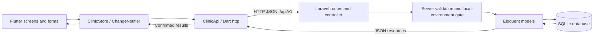

# Architecture

> Veritas Prototype 0.1 · Vista Care clinic administration
> Current implementation: 18 October 2026

Related documents: [Workflows](WORKFLOW.md) · [Product requirements](PRD.md) · [Design system](DESIGNSYSTEM.md) · [Setup](README.md)

## 01 · System overview

The project uses **Flutter for the frontend, Laravel 12 for the REST API, and
a database accessed through Laravel's Eloquent ORM**. Local development uses
SQLite. Flutter never connects directly to the database.

The current integration persists branch information, daily reports, and
medicine batches. Authentication, clinical records, billing transactions,
approval workflows, and audit trails remain future work.



The project folder is `veritas_prototype 0.1`, its Flutter package remains
`demo_demo`, and the visible product brand is Vista Care.

## 02 · Technology stack

| Layer | Current implementation |
|---|---|
| UI | Flutter / Dart; Material 3 and shared custom widgets |
| UI state | ChangeNotifier, ListenableBuilder, page-local form/filter state |
| HTTP | Dart `http` package; JSON requests/responses and 12-second timeout |
| API | Laravel 12 / PHP ^8.2; versioned routes under `/api/v1` |
| Persistence | SQLite locally; Laravel migrations and Eloquent |
| Optional database | XAMPP MySQL can be configured later; not exercised by this integration |
| Motion | Flutter animations and Cupertino page transitions |
| Preview | Device Preview 3, iPhone 16 by default in debug |
| Verification | Flutter unit/widget tests; Laravel feature tests and PHPUnit |
| Web hosting | GitHub Pages for the explicit sample-data frontend only |

Laravel 12 was selected for the installed XAMPP PHP 8.2. Composer installs
locked backend dependencies. There is no handwritten JavaScript bridge
between Flutter and Laravel: the boundary is an ordinary HTTP REST API.

## 03 · Repository structure

```text
veritas_prototype 0.1/
├── frontend/
│   ├── lib/
│   │   ├── main.dart                    # Select API or explicit demo mode
│   │   ├── data/
│   │   │   ├── clinic_models.dart       # Models, JSON parsing, dates/currency
│   │   │   ├── clinic_api.dart          # HTTP requests and API errors
│   │   │   └── clinic_store.dart        # UI cache, aggregates, confirmed writes
│   │   ├── pages/                       # Dashboard, reports, branches, inventory
│   │   └── widgets/
│   │       ├── clinic_connection.dart   # Loading, connection error, retry
│   │       ├── save_dialog.dart         # Async saves, errors, duplicate-tap guard
│   │       ├── clinic_ui.dart           # Tokens, components, charts
│   │       └── app_motion.dart          # Shared motion
│   ├── test/                           # Existing UI/store and HTTP tests
│   ├── android/ ios/ web/ windows/ macos/ linux/
│   └── pubspec.yaml
├── backend/
│   ├── app/
│   │   ├── Http/Controllers/ClinicController.php
│   │   ├── Http/Middleware/LocalClinicApi.php
│   │   ├── Http/Resources/              # Report/batch response shapes
│   │   └── Models/                     # Branch, DailyReport, MedicineBatch
│   ├── routes/api.php                  # Versioned REST routes
│   ├── bootstrap/app.php               # Registers API routing
│   ├── config/cors.php
│   ├── database/migrations/
│   ├── database/seeders/ClinicDemoSeeder.php
│   └── tests/Feature/ClinicApiTest.php
├── scripts/                            # Windows Artisan/Composer helpers
├── .vscode/launch.json                  # Frontend run targets
├── .github/workflows/                  # CI and frontend Pages deployment
└── README.md / ARCHITECTURE.md / WORKFLOW.md / PRD.md / DESIGNSYSTEM.md
```

There is one Git repository at the root. Local `.env`, SQLite files,
`vendor`, Flutter caches, and build outputs remain ignored.

## 04 · Data ownership and schema

Laravel's database is the authority in API mode. `ClinicStore.remote` keeps
a UI snapshot and calculates visible aggregates; it is not durable storage.
The original in-memory store remains available for tests and explicit demos.

| Table | Important fields | Integrity |
|---|---|---|
| branches | ID, unique name, address, target, growth, staff JSON | Unique branch name |
| daily_reports | Branch ID, date, patients, revenue, expenses, notes | Foreign key; unique branch/date |
| medicine_batches | Branch ID, name, quantity, unit, expiry, threshold | Foreign key; one row per batch |

Reports use database decimal columns with two fractional digits. API decimal
amounts are returned as strings and parsed into Dart doubles for display
and aggregation. The UI displays whole pesos in summary cards and retains
two decimal places when editing reports.

Staff entries and ratings are illustrative JSON embedded in a branch; they
are not authenticated user accounts, live attendance records, or a review
submission system.

`ClinicDemoSeeder` initializes six branches, 30 reports per branch, and six
medicine batches per branch. It uses first-or-create behavior so rerunning
it preserves existing quantities and report edits. It is an explicit
development operation, not something performed on each app launch.

## 05 · REST API contract

All requests use `Accept: application/json`; writes also use
`Content-Type: application/json`. Successful responses wrap values in
`{"data": ...}`.

| Method | Endpoint under /api/v1 | Purpose | Success |
|---|---|---|---|
| GET | /branches | Branch metadata and sample staff | 200 |
| GET | /reports | Persisted daily reports | 200 |
| PUT | /branches/{id}/reports/{YYYY-MM-DD} | Create/replace report for branch/date | 200 |
| GET | /medicine-batches | Persisted inventory | 200 |
| POST | /medicine-batches | Create a distinct medicine batch | 201 |
| PATCH | /medicine-batches/{id} | Restock or set on-hand quantity | 200 |

Report write body:

```json
{
  "patients": 42,
  "revenue": 35000.25,
  "expenses": 12500.50,
  "notes": "Daily review completed."
}
```

Batch creation requires `branch_id`, `name`, `quantity`, `unit`,
`expiry` (YYYY-MM-DD), and `threshold`. The server assigns the ID.

Stock write bodies:

```json
{"operation": "restock", "quantity": 10}
```

```json
{"operation": "set", "quantity": 25}
```

Restocking adds to the server's current quantity inside a transaction with a
row lock. A correction explicitly replaces the on-hand amount. Stock
quantities and thresholds must be nonnegative integers; restock amounts
must be positive. The supported stock limit is 1,000,000,000.

Reports require nonnegative integer patients and nonnegative monetary
amounts with at most two decimal places. Patient count is capped at
1,000,000 and monetary amounts at 999,999,999,999.99. Notes are optional
nullable text, capped at 5000 characters. Future report dates are rejected.
New batches cannot have expiry before the Philippine clinic day.

Validation errors return 422 with field errors. Missing resources return
404. The local-only environment gate returns 503 outside local/testing.

There are no delete endpoints, authentication endpoints, pagination,
websocket subscriptions, or clinical/billing APIs in this version.

## 06 · Frontend request and save lifecycle

### Startup and refresh

1. Resolve `API_BASE_URL` before Device Preview changes simulated platform behavior.
2. Create a remote store unless `USE_DEMO_DATA=true` was explicitly requested.
3. Fetch branches, reports, and batches with three GET requests.
4. Replace the UI snapshot only when all requests succeed.
5. Display the dashboard after data is ready.

Startup shows loading or connection/retry screens. An empty database produces
a no-branches state. A failed refresh retains the last successful snapshot
and shows an error; it never silently switches to sample mode.

The refresh action requests a new snapshot. Other clients' changes appear
after refresh/reload; this is not real-time push synchronization. The three
GET requests are independent and do not guarantee a transactionally
consistent snapshot during concurrent edits.

### Mutations

1. Validate the form locally.
2. Disable duplicate submission and keep entered data in place.
3. Send the request and wait for Laravel's validation and database write.
4. Update local state using the server's returned record and ID.
5. Close the dialog only on success.

Rejected, timed-out, or disconnected saves show an error and retain the form.
Transport timeouts can have ambiguous outcomes if a write reached the server;
automatic retries and exactly-once mutation guarantees are not implemented.
Report PUT is naturally keyed by branch/date; batch creation and restocks
should be checked before retrying after an uncertain response.

Stock corrections and report edits currently use last-write behavior.
Version conflicts, full inventory event history, and audit records remain
future requirements.

## 07 · Local networking and access boundary

| Client | Default API base URL |
|---|---|
| Chrome / desktop / iOS simulator | http://127.0.0.1:8000/api/v1 |
| Android emulator | http://10.0.2.2:8000/api/v1 |
| Physical device / another computer | Supply the development server's reachable LAN URL |

Override with `--dart-define=API_BASE_URL=http://HOST:8000/api/v1`.
The default server binds to loopback. Shared LAN testing requires an
intentional server bind and reachable host/firewall configuration.

CORS accepts browser origins on localhost or 127.0.0.1 with any port.
Other browser origins are rejected. CORS is a browser policy, not user
authorization. Android debug/profile permits local HTTP; release Android
keeps its normal transport policy. macOS client networking is enabled.
Native iOS and physical-device behavior still require device validation.

**This is a local development API without authentication.** Routes are
enabled only in Laravel's local/testing environments. Do not change the
environment gate to expose clinic writes publicly without implementing
authentication and resource/branch policies.

## 08 · Deployment and demo behavior

GitHub Pages cannot execute PHP. Its workflow deliberately builds Flutter
with `USE_DEMO_DATA=true` and `HOSTED_PREVIEW=true`; that hosted sample
resets on reload and never calls a visitor's local Laravel server.

A shared API deployment needs PHP-capable hosting, a persistent database,
HTTPS, authentication, branch policies, approved browser origins, and a
configured frontend API URL. SQLite remains the exercised local database;
MySQL/PostgreSQL migrations and operations need testing before a switch.

## 09 · Verification and next architecture steps

Run Flutter checks inside `frontend` and Laravel checks using the root helpers:

```sh
flutter analyze
flutter test
flutter build web --profile --dart-define=HOSTED_PREVIEW=true --dart-define=USE_DEMO_DATA=true --base-href /veritas_prototype-0.1/
```

```powershell
.\scripts\artisan.cmd test
```

Tests cover HTTP serialization, server-confirmed saves, failed writes,
refresh failure/retry, duplicate-tap prevention, REST persistence, report
uniqueness, stock operations, validation, CORS, the environment gate, and
the earlier navigation/layout scenarios.

Next steps: identity and role/branch authorization, audit history, durable
submission/approval states, patient records, scheduling, transaction-level
billing, pagination, concurrency policies, notification delivery, and backup
and restore procedures. Installing a REST layer does not complete these
broader clinic workflows.
