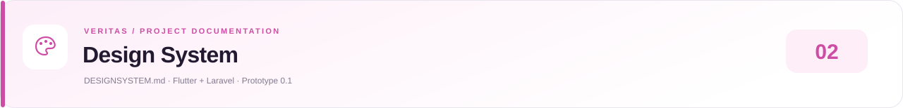

<!-- presentation:start -->

  
  
<a href="README.md">Overview</a> &nbsp;·&nbsp; <a href="ARCHITECTURE.md">Architecture</a> &nbsp;·&nbsp; <a href="DESIGNSYSTEM.md">Design System</a> &nbsp;·&nbsp; <a href="PRD.md">Product Requirements</a> &nbsp;·&nbsp; <a href="WORKFLOW.md">Clinic Workflows</a>

  
<a href="https://elijahdelmundo.github.io/veritas_prototype-0.1/docs/#designsystem">Open designed documentation ↗</a>

---
<!-- presentation:end -->

# Design System

> Veritas Prototype 0.1 · Vista Care interface
> Implementation reviewed: 16 October 2026

Visual foundations, reusable components, responsive behavior, and motion rules for the clinic dashboard.

Related documents: [Architecture](ARCHITECTURE.md) · [Product requirements](PRD.md) · [Workflows](WORKFLOW.md)

## 01 · Brand identity and principles

The interface uses **Vista Care** and an owner-portal identity. The folder name, `veritas_prototype 0.1`, is a project label; a product-wide rebrand has not been implemented.

- Use blue for navigation and primary actions, green for positive operational or financial context, and white surfaces for readable information.
- Put important numbers before supporting explanations.
- Group related information in rounded panels with generous spacing.
- Make branch and date scope visible wherever totals or edits depend on them.
- Use motion to explain navigation and acknowledge interaction.
- Show operational alerts neutrally. A discrepancy prompts review; it is not an accusation.

The supplied design-system image informs this document's structure. Its pink palette, Inter typeface, and Lucide icons are example choices, not this project's implementation.

## 02 · Color palette

Source of truth: `AppColors` in [clinic_ui.dart](frontend/lib/widgets/clinic_ui.dart) and the theme in [main.dart](frontend/lib/main.dart).

| Token | Hex | Use |
|---|---|---|
| `blue` | `#246BFD` | Primary actions, selected navigation, blue trends |
| `green` | `#229D78` | Positive status, collection and care highlights |
| `ink` | `#18283F` | Primary text |
| `muted` | `#8792A3` | Secondary labels and supporting text |
| `background` | `#F5F7FB` | Application canvas and filled inputs |
| `line` | `#EDF0F5` | Dividers and panel borders |
| `orange` | `#D68A22` | Stock and expiry attention states |
| Surface | `#FFFFFF` | Cards, navigation, and page surfaces |

| Additional treatment | Values |
|---|---|
| Home hero gradient | `#164FCB` → `#367EFF` |
| Revenue hero gradient | `#15775D` → `#2AA783` |
| Selected mobile indicator | `#EAF1FF` |
| Selected desktop tile | `#EDF3FF` |
| Status pill background | Status color at 9% alpha |
| Metric icon background | Metric color at 8% alpha |

Use theme-derived error colors for future validation work. Some fields currently use direct red text; a unified error token is not defined. Dark mode and a complete alternate palette are not implemented or verified.

## 03 · Typography

The theme requests **Segoe UI** without bundling a font asset. Platforms without it can fall back to another font; identical typography across devices is not guaranteed. Sizes below are Flutter logical pixels.

| Theme style | Size | Weight | Letter spacing | Role |
|---|---:|---:|---:|---|
| `headlineLarge` | 32 | 800 | -1.3 | Main dashboard heading |
| `headlineMedium` | 26 | 700 | -0.8 | Page/branch heading |
| `titleLarge` | 20 | 700 | -0.5 | Section title |
| `titleMedium` | 15 | 600 | Default | Compact heading |
| `bodyMedium` | 14 | Default | Default | Main body |
| `bodySmall` | 12 | Default | Default | Supporting copy |

Components also use 27/800 metric values, a 40/700 revenue hero amount, and 9–11 px metadata. Smaller styles require readability review; they are not an accessibility endorsement.

Use sentence case for actions. Reserve uppercase and wide tracking for short eyebrow labels. Pair amounts and counts with context: “patients today,” “last 7 days,” or “gross revenue (PHP).”

## 04 · Spacing and layout

The prototype uses explicit values rather than one enforced spacing-token class.

| Context | Current value |
|---|---:|
| Compact gaps | 4, 6, 8, 10, 12 |
| Form-field gaps / grid gaps | 14 |
| General content spacing | 16, 18, 20, 22, 24 |
| Section title spacing | 26 above / 14 below |
| Shell horizontal content padding | 20 compact / 36 wide |
| Shell content top / bottom | 28 / 32 |
| Standard panel padding | 22 |
| Metric card padding | 18 |
| Grid spacing | 14 horizontal and vertical |

Reuse these patterns for new screens. A future token consolidation should migrate existing widgets rather than create a competing scale.

## 05 · Radius, borders, and elevation

| Element | Treatment |
|---|---|
| Main panel | 24 px radius, 1 px line border |
| Home hero | 26 px radius |
| Input / filled button | 14 px radius |
| Sidebar tile / selector | 12 px radius |
| Selector menu | 16 px radius |
| Status pill / progress bar | 8 px radius |
| Panel shadow | `#030F274A`, blur 20, offset (0, 5) |

Keep depth subtle. Scale effects must preserve readable text and avoid clipping adjacent content.

## 06 · Components and interaction states

| Component | Responsibility | Rule |
|---|---|---|
| `Panel` | Shared surface, border, radius, shadow | Group content; a panel alone is not interactive |
| `MetricCard` | Icon, value, label, context | Name the metric and period |
| `SectionTitle` | Heading, optional subtitle/action | Keep actions specific to the section |
| `StatusPill` | Textual state | Use text as well as color |
| `ResponsiveGrid` | Wrapping layout with entrances | Set minimum width and maximum columns for content |
| `BranchSelector` | Shared branch scope | All branches plus six named branches |
| `TrendChart` | Trend line, fill, labels, reveal | Explain metric and period outside the chart |
| `StaffTile` | Identity, branch, sample rating | Do not imply live attendance or real reviews |
| `MotionPage` | Directional tab transitions | Use distinct page keys |
| `MotionEntrance` | Finite card entrance | Stagger related cards, not every text line |
| `MotionFeedback` | Branch-card hover/press | Preserve child interaction and semantics |

Use filled buttons for primary submission and text/outlined buttons for secondary actions. Forms use labeled Material fields, inline validation, cancel actions, and scrollable dialog content.

| State | Existing behavior / guideline |
|---|---|
| Empty reports | Explain the selected date has no reports and offer report creation |
| Empty inventory | State that no batches match the filters |
| Invalid input | Keep the form open and show field errors |
| Missing expiry | Show “An expiry date is required” |
| Server save succeeds | Update views from confirmed records and close the dialog |
| Loading / network failure | Show connecting or retry state; preserve the last snapshot on refresh failure |
| Permission denied | Planned; explain the restriction without exposing protected data |

## 07 · Icons

Existing screens use Flutter's Material `Icons`, primarily outlined and rounded variants. Common sizes are 16–24 px; metric icons are 20 px. Keep stroke style and icon size consistent within a row. Icon-only actions need a tooltip or accessible label. Do not add a second icon library solely to imitate the reference image.

## 08 · Responsive behavior

The actual shell navigation breakpoint is **1000 logical pixels**:

| Width | Shell |
|---|---|
| Below 1000 | Five-destination bottom navigation |
| 1000 and above | 218 px sidebar, including inventory access |

Main shell content has a maximum width of 1180; branch detail uses 1000 and inventory 1050. `ResponsiveGrid` calculates columns from available width and a default minimum card width of 160, up to four columns. Branch cards use a minimum of 260 and up to three columns. This is content-driven wrapping rather than a fixed tablet breakpoint.

Tabs are Home, Daily reports, Statistics, Revenue, and Branches. Inventory opens from alerts, shortcuts, branch details, or the sidebar. Selecting another tab resets the shared scroll position to the top.

Debug builds default to iPhone 16 Device Preview. Use `--dart-define=DEVICE_PREVIEW=false` to inspect the host's actual dimensions. Device Preview is not native iOS execution.

## 09 · Motion specification

Sources: [app_motion.dart](frontend/lib/widgets/app_motion.dart) and `TrendChart` in [clinic_ui.dart](frontend/lib/widgets/clinic_ui.dart).

| Interaction | Implemented motion |
|---|---|
| Tab entry | 650 ms; starts at 28% horizontal travel, 20 px vertical offset, scale 0.94 → 1 with easeOutBack overshoot |
| Entry opacity | Fades in during the first 55% of progress |
| Tab exit | 300 ms; opposite travel up to 14%, fade-out, scale toward 0.955 |
| Direction | Relative tab order; accounts for RTL |
| Grid entrance | 620 ms; fade and 16 px upward settle; interval stagger capped at index seven |
| Chart reveal | 800 ms; left-to-right clipping with easeOutCubic |
| Branch-card feedback | 220 ms; press scale 0.98 / hover scale 1.008 |
| Pushed pages | Cupertino transitions across configured platforms |

Motion uses Flutter/Dart. Outgoing tab content ignores pointer events and is excluded from semantics. Reduced-motion handling checks MediaQuery's disable-animations flag and the host's reduce-motion feature; tab, entrance, chart, and route effects are skipped or shortened, and hover/press transforms become neutral.

Do not introduce endless decoration, expensive blur transitions, or animation that delays saving. Reuse shared motion components.

## 10 · Accessibility and content rules

These are requirements to verify, not completed certification:

- Support keyboard navigation, visible focus, and meaningful control labels.
- Review muted text contrast against each actual background.
- Test large text, small screens, and forms with the keyboard visible.
- Do not communicate stock or expiry status using color alone.
- Provide chart summaries; the custom painter does not currently expose a complete accessible data table.
- Preserve tooltips and adequate touch targets.
- Do not shrink essential labels merely to fit a card.
- Show branch/date context before replacing a saved report.

Dates follow the Philippine clinic day (UTC+8). Money is displayed as rounded whole Philippine pesos. Explicit demo builds must identify sample data and reset-on-restart behavior; local API builds show a database-connected status.

## 11 · Review checklist

Check phone and desktop widths, iPhone safe areas, tab direction, rapid tab changes, scroll reset, validation, empty results, keyboard use, large text, and reduced motion. Existing tests exercise 320 and 1440 px layouts; further device and accessibility checks remain manual.

When changing tokens, breakpoints, or motion, update this document and the corresponding source together.

## REST integration update - 18 October 2026

SaveDialog now provides pending, validation/error, and confirmed-save states. ClinicConnection provides startup loading, empty-branch, and retry screens. The header refresh action reloads persistent records. Existing tokens, layouts, and motion remain shared across API and explicit demo modes.
