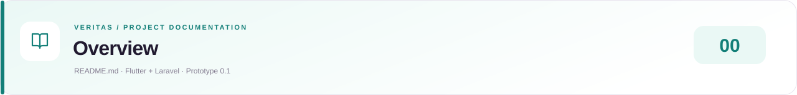

<!-- presentation:start -->
<div align="center">
  
  <p><a href="README.md">Overview</a> &nbsp;·&nbsp; <a href="ARCHITECTURE.md">Architecture</a> &nbsp;·&nbsp; <a href="DESIGNSYSTEM.md">Design System</a> &nbsp;·&nbsp; <a href="PRD.md">Product Requirements</a> &nbsp;·&nbsp; <a href="WORKFLOW.md">Clinic Workflows</a></p>
  <p><a href="https://elijahdelmundo.github.io/veritas_prototype-0.1/docs/#readme">Open designed documentation ↗</a></p>
</div>

---
<!-- presentation:end -->

# Veritas Prototype 0.1

Vista Care is a six-branch clinic dashboard with a **Flutter frontend and
Laravel 12 REST API**. Laravel stores local data in SQLite; Flutter displays
reports, inventory, branches, and calculated summaries.

## Layout

```text
frontend/        Flutter UI, HTTP client, models, tests, platform projects
backend/         Laravel API, models, migrations, seeders, tests
scripts/         Windows helpers for XAMPP PHP and Composer
.vscode/         Flutter launch configurations
.github/         Flutter/Laravel CI and GitHub Pages workflow
```

Keep the repository root open in VS Code. Run Flutter commands from
`frontend`; run the Windows helpers from the root.

## 1. Start Laravel

The installed setup uses XAMPP PHP 8.2 and Laravel 12. Helpers locate PHP on
PATH or fall back to `C:\xampp\php\php.exe`, and enable the installed ZIP
extension for Composer when needed without editing global PHP settings.

For this installed project, run:

```powershell
.\scripts\artisan.cmd migrate
.\scripts\artisan.cmd db:seed --class=ClinicDemoSeeder
.\scripts\artisan.cmd serve --host=127.0.0.1 --port=8000
```

Seeding creates six sample branches, 180 reports, and 36 batches. Rerunning
the seeder preserves existing report and quantity edits.

Useful URLs:

- http://127.0.0.1:8000/ — Laravel welcome page.
- http://127.0.0.1:8000/up — framework health.
- http://127.0.0.1:8000/api/v1/branches — REST branch data.
- http://127.0.0.1:8000/api/v1/reports — stored daily reports.
- http://127.0.0.1:8000/api/v1/medicine-batches — stored inventory.

## 2. Start Flutter

In another terminal:

```powershell
cd frontend
flutter pub get
flutter run -d chrome
```

This now connects to Laravel by default. Report and inventory edits persist
in the database across app restarts. Failed connections show Retry; failed
saves preserve form input.

For the full browser layout:

```powershell
flutter run -d chrome --dart-define=DEVICE_PREVIEW=false
```

Default API URLs:

| Client | URL |
|---|---|
| Chrome / desktop / iOS simulator | http://127.0.0.1:8000/api/v1 |
| Android emulator | http://10.0.2.2:8000/api/v1 |

Override for another server:

```powershell
flutter run -d chrome --dart-define=API_BASE_URL=http://127.0.0.1:8000/api/v1
```

A physical phone or another computer needs a reachable development host
address; its localhost is not your computer. Intentional LAN testing also
requires a server bind such as `--host=0.0.0.0`, network/firewall access, and
an appropriate browser-origin policy. Native iOS still needs device testing.

## 3. Try persistence

1. Open Daily reports, edit today's Pasig report, and save.
2. Reload Flutter: the edited report is fetched from Laravel.
3. Open inventory and restock a batch or set its on-hand quantity.
4. Reload again: the quantity and expiry are retained.
5. Use the header refresh action to fetch another client's committed changes.

This is request/response synchronization, not live push updates.
Users must connect to the same backend to share data. Separate local
SQLite files on groupmates' computers remain separate databases.

## Explicit offline/design demo

To view the design without running Laravel:

```powershell
cd frontend
flutter run -d chrome --dart-define=USE_DEMO_DATA=true
```

Only this explicit mode creates in-memory sample data and resets on reload.
A connection failure in API mode never silently switches to demo mode.

Device Preview starts with iPhone 16 in debug. Open **Dart: Open DevTools**
and the **device_preview** extension to change devices. It is a layout
simulation, not an actual iOS runtime.

## Fresh clone setup

Install Flutter, PHP compatible with Laravel 12, and Composer. With PHP and
Composer on PATH, run this from the root:

```powershell
cd backend
composer install
Copy-Item .env.example .env
php artisan key:generate
if (-not (Test-Path database/database.sqlite)) { New-Item -ItemType File database/database.sqlite }
php artisan migrate
php artisan db:seed --class=ClinicDemoSeeder
php artisan serve --host=127.0.0.1 --port=8000
```

Do not overwrite an existing `.env` or regenerate an existing application
key when following fresh-clone instructions. On this XAMPP computer the
root helpers can replace `php artisan` and `composer` commands.

Local `backend/.env`, application keys, SQLite data, `vendor`, and frontend
build/caches are ignored. Commit migrations, `.env.example`, source, and
lockfiles. No Node build is needed for the current API.

## Database and access boundary

SQLite is the exercised local database. XAMPP MySQL can be configured later
by creating a database, changing Laravel's `DB_*` environment values, and
running migrations; it has not been verified by this integration.

The prototype API is enabled only in Laravel local/testing environments.
It has no login, user/branch authorization, medical records, approval
workflow, or audit log yet. CORS accepts browser origins on localhost and
127.0.0.1; it is not an authentication mechanism.

Use sample data locally. Before public multiuser deployment, implement
identity, server-enforced permissions, HTTPS, and the required audit rules.

## Verification

From `frontend`:

```sh
flutter analyze
flutter test
```

From the root:

```powershell
.\scripts\composer.cmd validate --strict
.\scripts\composer.cmd check-platform-reqs
.\scripts\artisan.cmd test
```

## GitHub Pages

https://elijahdelmundo.github.io/veritas_prototype-0.1/

Pages hosts only the Flutter frontend and cannot execute Laravel.
The workflow builds from `frontend` with explicit demo mode:

```sh
flutter build web --profile --dart-define=HOSTED_PREVIEW=true --dart-define=USE_DEMO_DATA=true --base-href /veritas_prototype-0.1/
```

The hosted iPhone design demo resets on reload and does not connect to a
visitor's localhost. A real shared API requires separate PHP-capable
hosting and a deployed frontend configured with its HTTPS API URL.

## Documentation

- [Architecture](ARCHITECTURE.md): components, schema, REST contract, deployment boundaries.
- [Workflow](WORKFLOW.md): connected report/inventory journeys and planned clinic operations.
- [Design system](DESIGNSYSTEM.md): visual tokens, components, responsiveness, motion.
- [PRD](PRD.md): product scope and future requirements.
- [Backend](backend/README.md): Laravel-specific setup.
