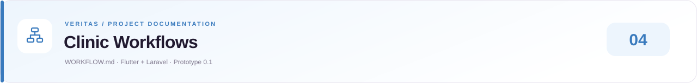
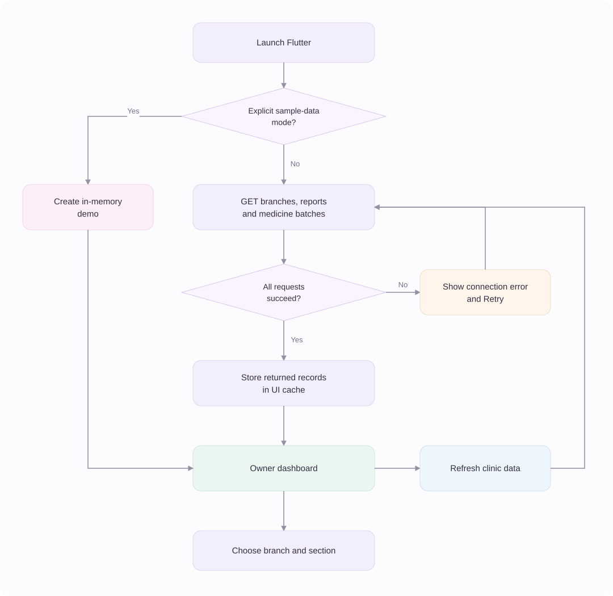
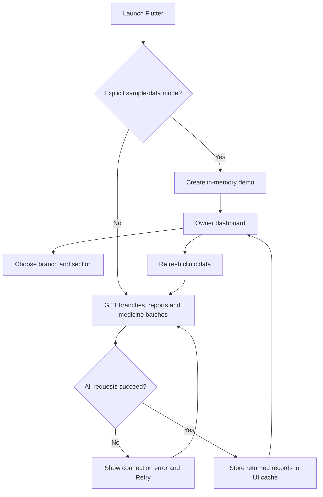
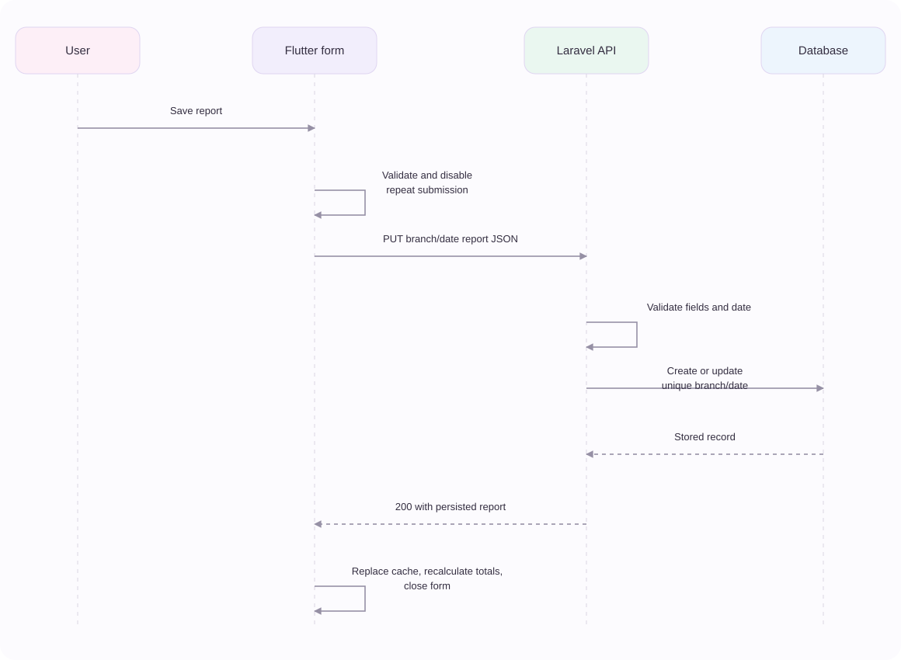
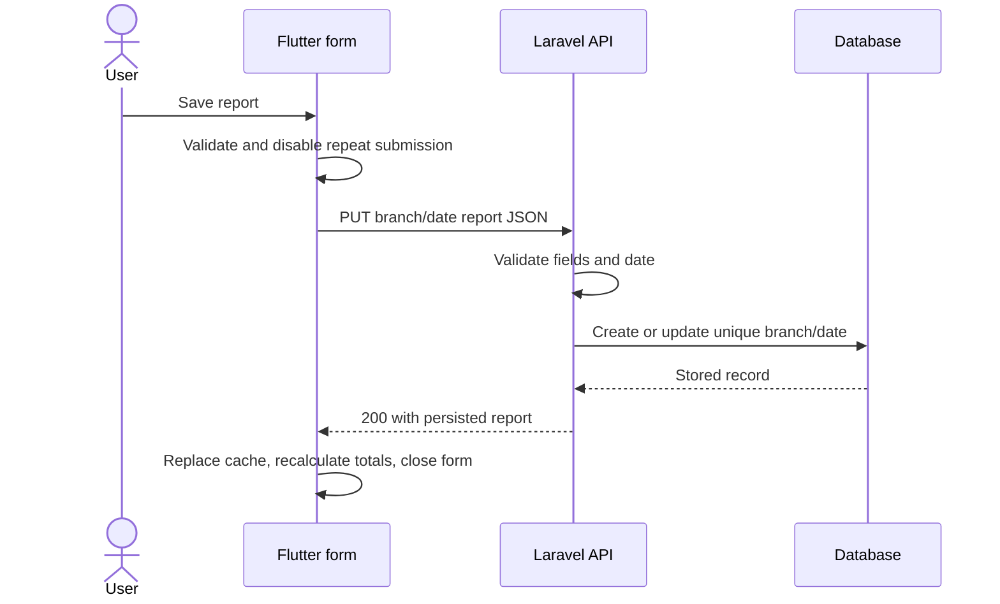
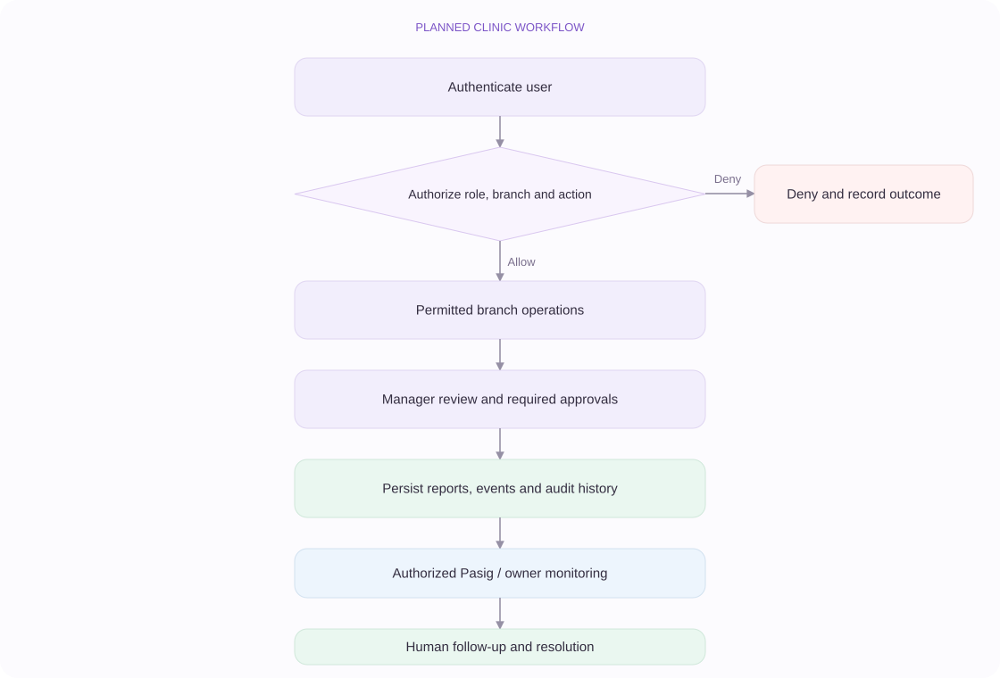
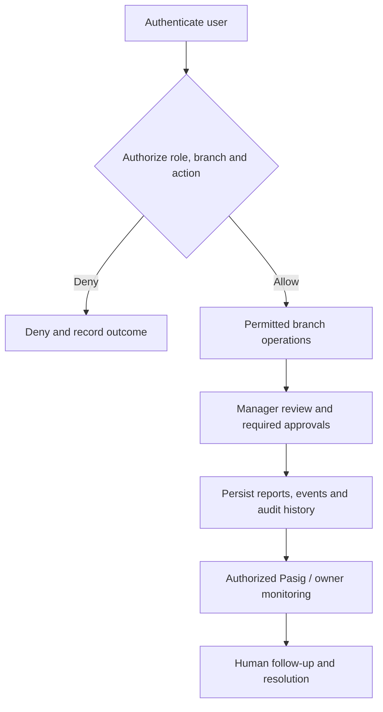

<!-- presentation:start -->
<div align="center">
  
  <p><a href="README.md">Overview</a> &nbsp;·&nbsp; <a href="ARCHITECTURE.md">Architecture</a> &nbsp;·&nbsp; <a href="DESIGNSYSTEM.md">Design System</a> &nbsp;·&nbsp; <a href="PRD.md">Product Requirements</a> &nbsp;·&nbsp; <a href="WORKFLOW.md">Clinic Workflows</a></p>
  <p><a href="https://elijahdelmundo.github.io/veritas_prototype-0.1/docs/#workflow">Open designed documentation ↗</a></p>
</div>

---
<!-- presentation:end -->

# Clinic Workflows

> Veritas Prototype 0.1 · Flutter + Laravel REST API
> Current implementation: 18 October 2026

Related documents: [Architecture and API contract](ARCHITECTURE.md) · [Setup](README.md) · [Requirements](PRD.md)

## 01 · Current scope

The six branches are Laguna, Pasig, Caloocan, Parañaque, Quezon City, and
Valenzuela. Pasig remains the intended central administration hub.

| Implemented locally | Still planned |
|---|---|
| Flutter dashboard with Laravel HTTP requests | Login and server-enforced user/branch permissions |
| Persistent daily reports | Formal submission, review, approval, and correction history |
| Persistent medicine batches and quantity changes | Transfers, movement ledger, purchase requests |
| Branch metadata and sample staff ratings | User administration and live attendance |
| Visit/revenue summaries and local stock/expiry calculations | Patient records, appointments, billing transactions |
| Loading, retry, refresh, and failed-save feedback | Audit trail, delivered notifications, offline write queue |

Laravel owns the database. Flutter owns presentation, forms, navigation,
branch display filters, and calculated dashboard summaries.

The API currently has a local/testing environment restriction and no
authenticated roles. Do not treat branch selection as authorization.

## 02 · Prepare the local system

From the repository root:

```powershell
.\scripts\artisan.cmd migrate
.\scripts\artisan.cmd db:seed --class=ClinicDemoSeeder
.\scripts\artisan.cmd serve --host=127.0.0.1 --port=8000
```

In another terminal:

```powershell
cd frontend
flutter pub get
flutter run -d chrome
```

The explicit demo seeder creates sample branches, reports, and batches.
Rerunning it preserves saved quantities and existing reports. Normal
Flutter restarts fetch stored data instead of recreating it.

An Android emulator uses 10.0.2.2 to reach the development computer. For
another host use `--dart-define=API_BASE_URL=http://HOST:8000/api/v1`;
server binding and network access must also allow that host.

## 03 · Application startup and navigation

<!-- presentation:start -->


<details>
<summary>View Mermaid diagram source</summary>

<!-- presentation:end -->

<!-- presentation:start -->
</details>
<!-- presentation:end -->

1. Local app startup uses the Laravel API by default.
2. Show a connecting state while loading the three resource collections.
3. If a request fails, show an error and Retry; do not substitute demo data.
4. If no branches exist, show an empty setup state.
5. Once loaded, show Home, Daily reports, Statistics, Revenue, and Branches.
6. Inventory opens through alerts, shortcuts, branch details, or the sidebar.
7. Branch selection narrows displayed data; the API currently returns all prototype branches.

Changing tabs preserves the existing motion and resets the shared scroll
position to the top. Refresh fetches other users' committed changes.
If refresh fails after a successful load, the current snapshot remains
visible and the refresh error is reported.

## 04 · Create or replace a daily report

1. Open Daily reports and choose a date; the UI allows today and the previous 365 days.
2. Create a report or edit an existing one.
3. Choose a branch for creation. Editing keeps its branch fixed.
4. Enter whole-number patient count, revenue, expenses, and optional notes.
5. Run local validation, then show a saving state with repeat submission disabled.
6. Send PUT to `/api/v1/branches/{id}/reports/{YYYY-MM-DD}`.
7. Laravel validates the values and report date.
8. Persist one report for that branch/date; replace its values if it already exists.
9. Return the stored report as JSON.
10. Update Flutter's cache and aggregates, then close the dialog.

<!-- presentation:start -->


<details>
<summary>View Mermaid diagram source</summary>

<!-- presentation:end -->

<!-- presentation:start -->
</details>
<!-- presentation:end -->

Patient count must be a nonnegative integer. Money must be nonnegative,
within the supported range, and have no more than two decimal places.
The server rejects future dates. Validation failures return 422 and keep
the form open with entered data and an error message.

The “Submitted” badge currently means a stored report exists. It does not
mean a manager has approved it or a separate submission deadline was met.
Refreshing/reopening the app reads the persisted report.

## 05 · Create a medicine batch

1. Open inventory and select Add medicine.
2. Choose branch, medicine name/strength, quantity, unit, threshold, and expiry.
3. Validate locally; a missing expiry keeps the form open.
4. POST to `/api/v1/medicine-batches` using the branch's database ID.
5. Laravel validates branch existence and field values.
6. Insert the batch and return 201 with its assigned ID.
7. Add the returned batch to Flutter's cache and recalculate attention counts.

Units are vials, tablets, capsules, bottles, or boxes. Quantity and threshold
are nonnegative integers. The server rejects past expiry for new batches.
A different-expiry delivery belongs in a separate batch.

Cancelling before submission leaves data unchanged. A failed response
retains the form; successful creation persists across app restarts.

## 06 · Restock or correct inventory

1. Search medicine/branch and choose all batches or needs attention.
2. Open Restock to add a positive quantity, or Adjust stock to set the current count.
3. Send PATCH to `/api/v1/medicine-batches/{id}`.
4. Laravel validates the operation and quantity.
5. Inside a transaction, read/lock the current batch and apply the operation.
6. Return the stored batch.
7. Replace the cached record and recalculate alerts.

| Operation | Request | Result |
|---|---|---|
| Restock | operation=restock; quantity=10 | Add 10 to current server quantity |
| Correction | operation=set; quantity=25 | Set on-hand quantity to 25 |
| Invalid quantity/operation | Invalid JSON field values | 422; no committed quantity change |
| Missing batch | Unknown resource ID | 404; show error |

Corrections and restocks currently have no approval reason, movement
ledger, or audit record. Restocks are transactional; stock corrections and
report edits do not yet have version-conflict handling.

## 07 · Alerts and totals

Flutter recalculates these values from loaded records:

| Rule | Behavior |
|---|---|
| Clinic day | Philippine calendar date, UTC+8 |
| Low stock | Quantity at or below threshold |
| Expired | Expiry before the clinic day |
| Expiring soon | Not expired and within 60 days, including today |
| Attention | Any low/expired/expiring condition |
| Status priority | Expired → Low stock → Expiring soon → Healthy |
| Net revenue | Report collections minus operating expenses |
| Net margin | Net / gross × 100; guard zero gross |

Restocking does not change expiry. A restocked batch may remain in the
attention list because it expires soon. There is no delivered notification
service; these are in-app operational indicators.

## 08 · Errors and synchronization boundaries

| Situation | Current response |
|---|---|
| API unavailable at startup | Connection screen and Retry |
| Refresh fails | Retain last snapshot and show the error |
| Invalid form | Keep entered values and display validation feedback |
| Save pending | Disable repeat submission and editing |
| Server rejects save | Keep dialog open; do not change cached records |
| Missing resource | Display the API error; refresh to retrieve current data |
| Timeout | Display error; verify server state before retrying uncertain writes |
| Another client writes | Refresh or reopen to fetch committed changes |
| API in production environment | Local-only gate returns 503 |
| Explicit demo build | Use in-memory data; reset on restart/reload |

There is no automatic polling, offline write queue, websocket synchronization,
or exactly-once retry mechanism. A timeout can occur after the server has
committed a request. Check the resulting data before repeating batch
creation or a restock.

## 09 · Hosted demo versus shared backend

GitHub Pages builds with `USE_DEMO_DATA=true`; it shows the design with sample
data and does not contact the local API. It cannot run Laravel.

Groupmates can clone the repository and run their own local databases.
Those databases are separate. To share data, clients must intentionally
connect to the same reachable API/database; authentication and permissions
must be implemented before public deployment.

## 10 · Secure clinic workflows — planned

The original broader operating requirements remain part of the product
direction. The REST integration above does not implement these processes.

### A. Secure login and zero-trust access

Verify credentials, identity, role, assigned branch, module, resource, and
action for every request. Deny unauthorized operations and record relevant
access attempts. Apply minimal field access; a successful login does not
authorize all later requests.

| Role | Intended scope |
|---|---|
| Owner / CEO / authorized main administrator | Authorized all-branch operations, user/role management, reporting and audit oversight |
| Pasig manager | Pasig operations; central access requires additional permission |
| Other branch manager | Assigned-branch operations and permitted approvals |
| Reception | Basic identity/registration and appointments |
| Billing | Payments, sales, refunds; no private clinical notes |
| Inventory | Stock events, transfers, expiry and history; no clinical records |
| Nurse / authorized staff | Minimum information required for assigned services |
| Doctor | Authorized clinical history and permitted clinical note changes; billing only with separate permission |

### B. Patient records and cross-branch access

Search centralized patient identities and prevent duplicates. Create or
retrieve the identity, then apply role/branch field restrictions. Reception
sees registration details; nurses see permitted service information; doctors
see authorized clinical records and may make permitted note corrections.

Additional cross-branch information requires a request, authorized review,
minimal release, or a recorded denial reason. Audit relevant record access,
changes, requests, decisions, and releases.

### C. Doctor attendance and scheduling

Record QR time-in/time-out, timestamp, doctor, assigned/actual branch, and
attendance status. Managers confirm duty branch. Compare appointment branch,
time, assignment, and availability.

Confirm compatible appointments. For conflicts, notify branch management
and authorized Pasig administrators; human reviewers assign another doctor,
reassign/reschedule, or notify the patient through approved staff channels.
Record the action, reason, appointment status, and audit context.

### D. Inventory transfers and replenishment

Record stock-in/out, usage, expiry, corrections, and movement history.
Review low-stock and discrepancy alerts. If another branch can supply stock,
submit and approve/deny a transfer; otherwise request replenishment.

Fulfillment must preserve batch expiry and update both inventories atomically
without negative available stock. Keep request, decision, movement, and
adjustment history. An alert must never automatically accuse a person of
fraud or misconduct.

### E. Sales, billing, and refunds

Billing staff record services, payments, and branch. Refunds need a reason
and authorized manager review. Preserve the original transaction and audit
approval/rejection and financial changes. Billing access is separate from
medical-note access.

### F. Reviewed daily branch submission

Collect patient count, completed services, sales/payments, refunds, inventory
movements, low stock, staff attendance, schedule status, and conflicts.
Managers review completeness and request corrections.

Submit after closing, preferably after 5 PM clinic time; persist submission
identity/time and later corrections. The preferred time is a process
guideline until a formal cutoff policy is agreed.

### G. Pasig central monitoring

Authorized management reviews consolidated/branch reports, sales, visits,
returning patients/follow-ups, attendance, conflicts, inventory, fast-moving
supplies, and access/discrepancy alerts when those modules exist. Inspect
supporting records, assign follow-up, and track resolution and audit history.

<!-- presentation:start -->


<details>
<summary>View Mermaid diagram source</summary>

<!-- presentation:end -->

<!-- presentation:start -->
</details>
<!-- presentation:end -->

## 11 · Verification

Existing tests cover navigation/layout, report replacement, stock attention,
HTTP parsing, confirmed and failed saves, connection retry, API validation,
database persistence, CORS, and local-only behavior. See
[Flutter API tests](frontend/test/clinic_api_test.dart) and
[Laravel API tests](backend/tests/Feature/ClinicApiTest.php).

Before production, add role/branch allow-deny coverage, clinical privacy
tests, approvals, conflict handling, audit completeness, notification
delivery, and durable deployment/restore checks.
