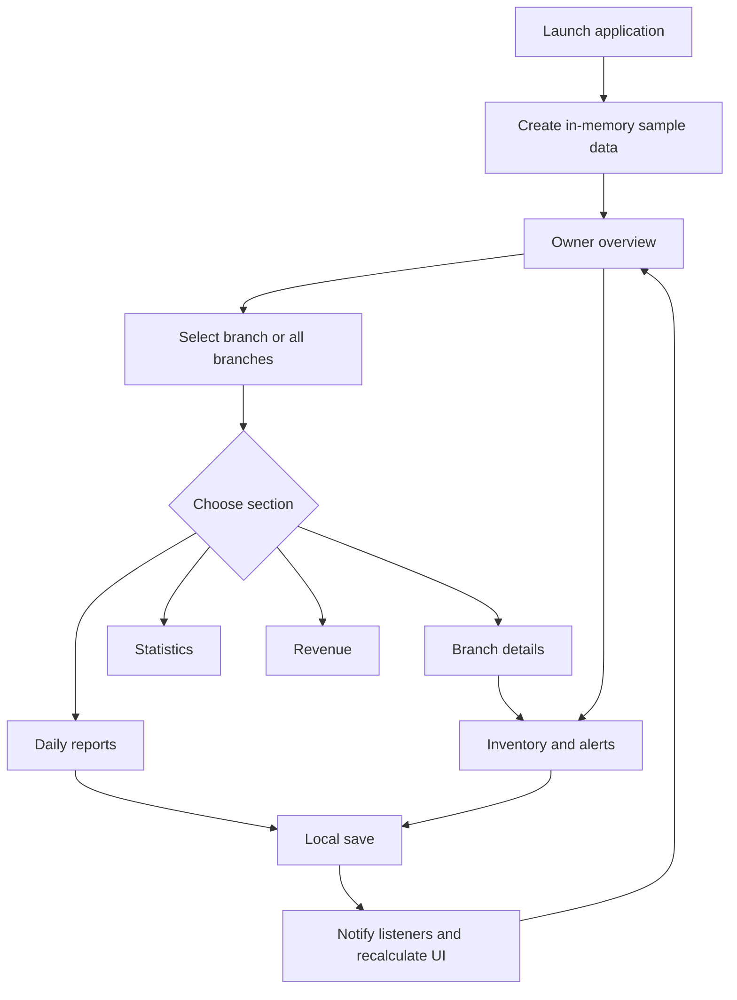
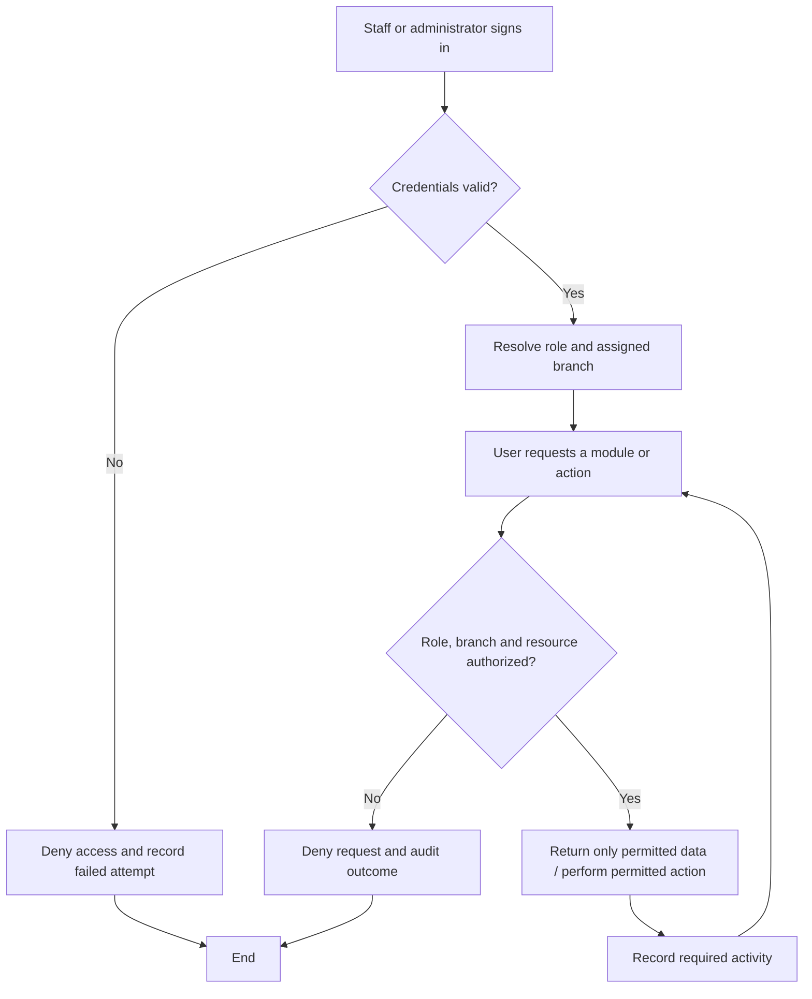
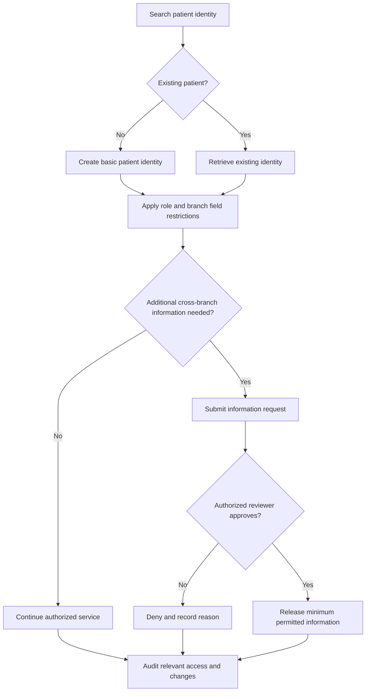
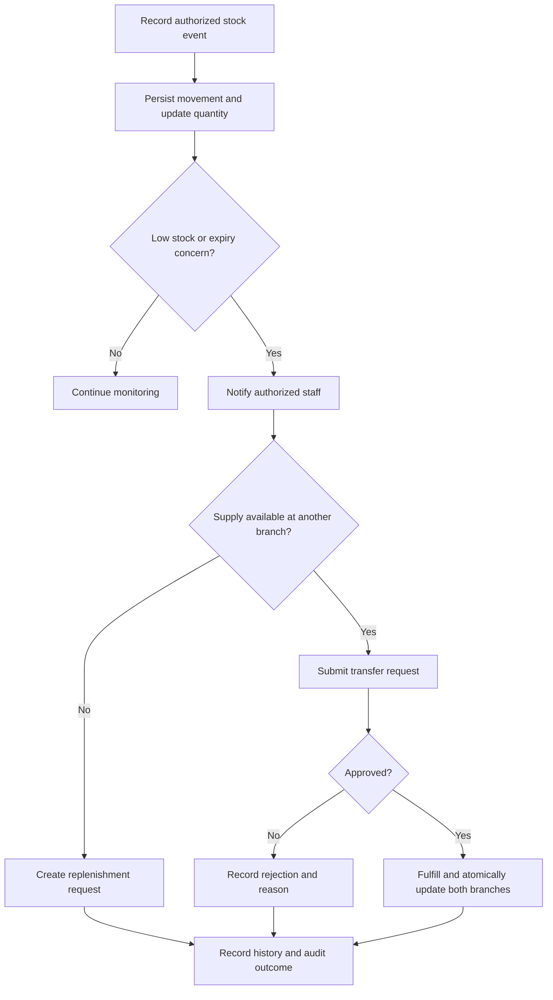
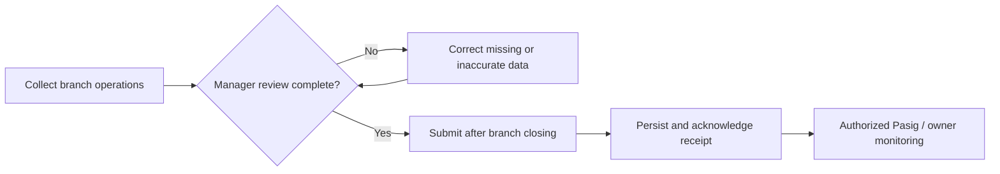

# Clinic Workflows

> Veritas Prototype 0.1 · Centralized Multi-Branch Clinic Administration System
> Updated: 16 October 2026

Operational journeys for the current dashboard and the intended secure clinic system. The original workflow requirements are organized below; future capabilities are explicitly marked.

Related documents: [Product requirements](PRD.md) · [Architecture](ARCHITECTURE.md) · [Design system](DESIGNSYSTEM.md)

## 01 · Scope and branch network

The six branches are **Laguna, Pasig, Caloocan, Parañaque, Quezon City, and Valenzuela**. Pasig is the proposed main administration hub.

| Available in the prototype | Planned for the production system |
|---|---|
| Direct owner-dashboard entry | Secure login and role/branch authorization |
| Local report entry and editing | Approved, persistent, synchronized operational reporting |
| Local medicine batches and quantity edits | Stock movement history, transfers, approvals, replenishment |
| In-app stock/expiry attention lists | Delivered notifications and tracked resolution |
| Aggregate visits, revenue, staff samples | Individual patient records, attendance, appointments, billing |
| Local branch display filters | Server-enforced branch and clinical-data restrictions |
| Recalculated UI after changes | Audit history and shared cross-branch updates |

The prototype contains no patient-facing system. Patient notifications mentioned below are staff-managed operational actions, not a patient app.

## 02 · Current prototype journey

### A. Open, navigate, and choose scope

1. Launch the Flutter application.
2. In debug mode, Device Preview starts with iPhone 16 dimensions unless disabled.
3. The app creates sample data and opens the owner overview directly.
4. Choose a branch or “All branches.”
5. Switch among Home, Daily reports, Statistics, Revenue, and Branches.
6. Open inventory from an alert, shortcut, branch detail, or desktop sidebar.

Tab switches reset scroll to the top and use directional motion. The selected branch is shared across dashboard sections. This is filtering, not a security boundary.

### B. Enter or edit a daily report

1. Open Daily reports and choose the clinic date. The picker allows today and dates within the preceding 365 days.
2. Select “Daily report” or an existing report's edit action.
3. For a new report, choose a branch. The default is the selected branch or Pasig when viewing all branches.
4. Enter whole-number patient count, gross revenue, operating expenses, and optional notes.
5. Save only after validation succeeds. Patient count must be a nonnegative integer; monetary values must be finite and nonnegative.
6. Replace the existing report for that branch/date, if present.
7. Close the form and recalculate dashboard totals.

Cancel leaves data unchanged. Invalid input keeps the form open. A missing report list displays an empty-state explanation. Editing locks the report's branch in the form.

“Submitted” currently means a local report object exists. There is no sign-off, deadline enforcement, delivery confirmation, or audit record. Changes disappear on a full app restart.

### C. Add a medicine batch

1. Open inventory and choose “Add medicine.”
2. Select branch; enter medicine name/strength, quantity, unit, and low-stock threshold.
3. Select an expiry date. Available units are vials, tablets, capsules, bottles, and boxes.
4. Validate a nonblank name, nonnegative integer quantity/threshold, and required expiry.
5. Save the new batch and recalculate inventory totals and alerts.

The date picker allows today through approximately ten years ahead. A delivery with a different expiry should be a separate batch. Cancel does not add a batch.

### D. Restock or correct a quantity

1. Find the batch using medicine/branch search and the all/attention filter.
2. Choose restock to add a positive whole-number quantity.
3. Choose quantity correction to set a nonnegative on-hand quantity.
4. Save; the store applies the quantity delta and updates listening screens.
5. Review the remaining attention flags.

A batch can be both low and near expiry. Restocking removes only the low-stock condition when quantity becomes greater than the threshold; it does not change expiry.

| Condition | Current rule |
|---|---|
| Low stock | Quantity ≤ configured threshold |
| Expired | Expiry before the current Philippine clinic day |
| Expiring soon | Not expired; within 60 days, including today |
| Attention | Any of the above |
| Status text priority | Expired → Low stock → Expiring soon → Healthy |

Current edits have no movement reason, approval step, or persistent history.

## 03 · Secure login and zero-trust access — planned

Applies to PRD requirements P01–P04.

Every request must verify identity, role, branch, module, resource, and action. A previously successful login does not authorize every subsequent operation. Direct links or API requests must receive the same checks as visible UI controls.

| Role | Intended access |
|---|---|
| Owner / CEO / authorized main administrator | All-branch operational overview, consolidated reports, alerts, user/role management, audit review within granted permissions |
| Pasig manager | Pasig operations; central oversight requires explicit additional permission |
| Other branch manager | Assigned-branch reports, inventory, sales, attendance, and permitted approvals |
| Reception | Basic patient identity/registration and appointments |
| Billing | Payments, sales, and refund processing; no private clinical notes |
| Inventory | Stock events, transfers, requests, and inventory history; no private medical records |
| Nurse / authorized staff | Service information allowed by role and assigned branch |
| Doctor | Authorized clinical history; permitted creation/correction of their clinical notes with audit history |

Billing access for a doctor requires separate permission. All-branch operational oversight does not imply unrestricted clinical access.

## 04 · Branch operations — planned

### A. Patient records and cross-branch requests

Applies to P05–P07.

1. Reception searches the centralized patient identity index using permitted basic information.
2. If the patient exists, retrieve the existing identity; otherwise create a new record after duplicate checks.
3. Apply role and branch rules before revealing any fields.
4. Reception sees registration details, nurses see service-relevant information, and doctors see authorized clinical history.
5. Only authorized doctors add or correct clinical notes; record user, date/time, and changes.
6. If extra information from another branch is required, submit an information request.
7. An authorized reviewer approves or denies it. Approval releases only the necessary permitted information; denial records a reason.
8. Audit patient access, note changes, requests, decisions, and information release.

An access request is not a general exemption from clinical permissions. Unauthorized requests remain denied even if a user can search a patient's basic identity.

### B. Doctor attendance and appointments

Applies to P08–P09.

1. Doctor or authorized staff scans a QR code for time-in/time-out.
2. Record timestamp, doctor, assigned branch, actual branch, and attendance status.
3. Branch management confirms the duty branch.
4. Synchronize schedule information for authorized Pasig monitoring.
5. Compare the appointment's branch/time with the doctor's assignment and availability.
6. If compatible, confirm the appointment, notify branch staff, and save its status.
7. Otherwise create a scheduling conflict alert for the branch manager and Pasig main administrator.
8. Human reviewers verify actual location/schedule and assign another available doctor, reassign/reschedule the appointment, or notify the patient through approved staff channels.
9. Update appointment status and audit the conflict, decision, reason, and notifications.

A QR scan alone must not silently resolve a conflicting schedule. Confirmation and reassignment permissions need explicit policy.

### C. Inventory movements, transfers, and replenishment

Applies to P11–P12 and P15.

1. Authorized staff record stock-in, stock-out, usage, expiry information, or a justified correction.
2. Persist the movement and recalculate branch inventory.
3. Check low-stock and expiry rules; identify discrepancies for human review.
4. Notify branch management, inventory staff, and authorized central management.
5. Check whether another branch can supply a shortage.
6. Submit a transfer request if stock is available; otherwise request purchase/replenishment.
7. An authorized reviewer approves or denies the transfer and records a reason.
8. After approval and the defined fulfillment step, update source and destination inventories atomically.
9. Preserve request, decision, movement, expiry, and adjustment history.

Expiry alerts need appropriate review even when enough stock is available. Transfers must preserve batch identity/expiry and cannot create negative available stock. Reservation, dispatch, and receipt rules remain design decisions.

### D. Sales, payments, and refunds

Applies to P10.

1. Billing staff record patient services, payment details, and branch.
2. Validate and save the transaction under the assigned branch.
3. Include completed transactions in branch sales totals.
4. If a refund is requested, require its reason and route it to an authorized manager.
5. Record approval/rejection; apply an approved refund without erasing the original transaction.
6. Audit the request, decision, and resulting financial change.
7. Include sales/refunds in the branch daily report.

Billing staff cannot access private clinical notes. The prototype's gross-revenue form is an aggregate entry, not this transaction ledger.

### E. Daily branch reporting

Applies to P13.

1. Collect patient count, services completed, sales/payments, refunds, inventory movements, low-stock items, staff attendance, doctor schedule status, and conflicts.
2. The branch manager checks completeness and accuracy.
3. Return incomplete information for correction; audit changes.
4. Submit after closing, preferably after 5 PM Philippine clinic time.
5. Persist the report centrally and expose it to authorized Pasig/owner users.
6. Record actor, branch, clinic date, submission time, and subsequent corrections.

The preferred submission time is a workflow guideline until a cutoff policy is agreed. Offline submissions, duplicate retries, late corrections, and finalization rules must be defined before implementation.

## 05 · Pasig central administration and monitoring — planned

Applies to P14–P16.

1. An authorized main administrator or CEO opens the central dashboard.
2. Select all branches or a permitted individual branch.
3. Review consolidated and branch daily reports, sales performance, and patient volumes.
4. Review returning patients/follow-ups, staff attendance, doctor assignment conflicts, inventory, fast-moving supplies, and access/discrepancy alerts once their underlying modules exist.
5. Compare branches and inspect supporting information before drawing conclusions.
6. Assign follow-up actions to authorized staff and track resolution.
7. Review audit history for logins, requests, edits, approvals, refunds, transfers, and submissions.
8. Keep reports, alerts, and audit records available only to authorized management.

**End state:** management can inspect a trustworthy operational summary and the actions behind it. The current dashboard demonstrates only part of this journey with sample data.

## 06 · Exceptions and operating rules

| Situation | Required handling |
|---|---|
| Invalid or expired identity | Deny access; request reauthentication; audit as appropriate |
| Wrong branch or forbidden module | Deny on the server; do not disclose protected fields |
| Rejected information/transfer/refund request | Preserve decision, reason, reviewer, and timestamp |
| Concurrent report changes | Surface a conflict rather than silently overwriting another user's work |
| Failed network save | Preserve draft input and show an unconfirmed state; do not claim success |
| Partial stock transfer failure | Keep both inventories consistent through an atomic operation |
| Scheduling conflict | Human review and explicit appointment/status update |
| Inventory discrepancy | Neutral alert with investigation; no automated accusation |
| Full prototype restart | Sample data is recreated; local edits are lost |

## 07 · Workflow verification

For the prototype, verify navigation and branch filters, report replacement, required expiry, valid stock changes, expiry retention after restock, and cancellation behavior. Existing automated checks are in [store tests](test/clinic_store_test.dart) and [widget tests](test/widget_test.dart).

Before a production pilot, verify every role/branch allow-deny combination, minimal patient fields, cross-branch decisions, QR and scheduling conflicts, refund approvals, atomic transfers, report synchronization, and audit completeness.

Approve the unresolved policies in [PRD.md](PRD.md) before turning these planned workflows into production behavior.
